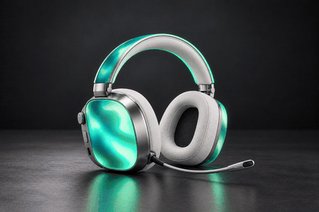
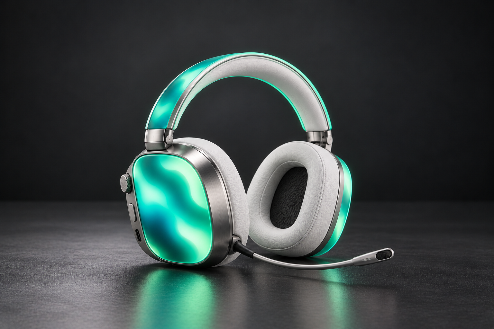

# Verdant — compact emerald gaming headset

A new, shorter design with broader earcups, a circular headband, white leather cushions, brushed-silver hardware and the approved emerald/teal flowing-light finish.

## Watch the complete 30-second preview

[Download the full-quality 30-second MP4](https://github.com/hxssin04-collab/headphones-spec/raw/refs/heads/headset-preview/verdant-30s/verdant-headset-30-seconds.mp4)

Continuous light animation and camera movement across the full 30 seconds. The preview repeats after the complete sequence.

This is an animated design rendering based on a generated still, with masked material movement, changing illumination and camera framing. It is not a full 3D orbit or footage of working hardware. Physical dimensions, mass, comfort and lighting hardware remain subject to engineering validation.
